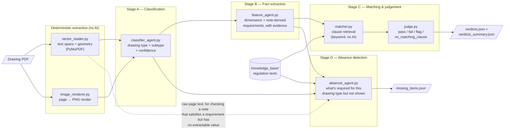
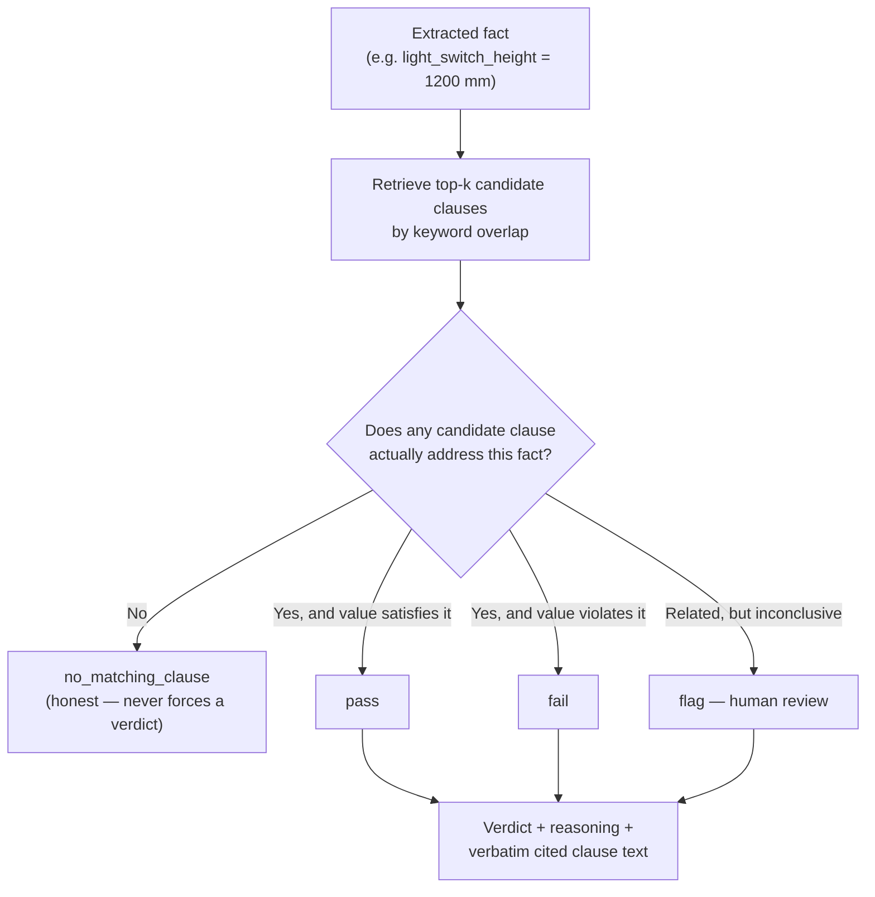
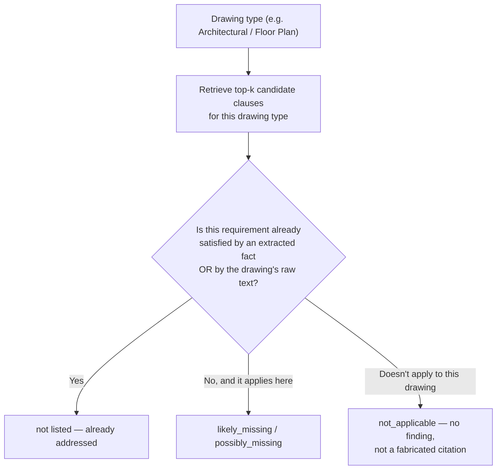

# Architectural Drawing Compliance Pipeline

An AI pipeline that reads CAD-exported architectural drawing PDFs and checks them against
UK (Northern Ireland) building regulations — producing **pass / fail / flag verdicts, plus
requirements the drawing doesn't show at all, with the exact regulation clause cited as evidence**
for every finding.

A personal R&D project. Prototype status: working end-to-end on real drawing sets.

---

## What it does

Give it a drawing PDF (floor plan, electrical plan, elevation, …) and it will:

1. **Classify** every page by drawing type, fusing the PDF's vector text/geometry with a rendered image.
2. **Extract** every compliance-relevant fact on the page — labelled dimensions *and* requirements
   written in specification notes (U-values, material grades, mounting heights, named standards).
3. **Match** each fact against a knowledge base of building-regulation clauses and **judge** it:
   `pass`, `fail`, `flag` (needs human review), or `no_matching_clause` — never forcing a verdict
   onto an irrelevant clause.
4. **Check for absence** — not just whether present values are correct, but whether something the
   regulations expect for this drawing type was never shown at all. This is the harder, more common
   real-world case: most actual Building Control rejections are "please provide X," not "X is wrong."

The app presents this as two pages: **Analysis** (classification + extracted facts, Stages A+B) and
**Report** (one written document combining Stage C's checks and Stage D's missing-items findings,
downloadable as a PDF). Every finding traces back to a verbatim quote on the drawing and a verbatim
excerpt from the regulation document, so a human reviewer can verify any finding in seconds.

### Example of a real catch

On a real electrical plan, the pipeline flagged:

> **FAIL — `kitchen_outlet_height` = 1100 mm**
> *"Paragraph 5.41 of Technical Booklet R: 2012 specifies that socket outlets should be located
> not more than 1000 mm above floor level, whereas the drawing specifies 1100 mm."*
> — with the full clause text from `TechnicalBookletR2012.pdf` attached as evidence.

### Example of a real absence catch

Tested against a real approved floor plan from a live NI Building Control case (`25-110`), Stage D
correctly flagged a genuine gap and — after a fix described below — correctly *stopped* flagging
four things that were actually already on the drawing:

> **Likely missing — stair/ramp soffit protection**
> *"Any area below the soffit of a stair or a ramp... that is less than 2100 mm above a circulation
> route, should be protected by a distinguishable barrier rail..." (Technical Booklet R: 2012, 4.9)*
> — the drawing shows a stair with no such note anywhere on the sheet.

The first version of Stage D also flagged "door opening furniture visual contrast" as missing on
this same drawing — wrongly, since the drawing's own general notes quote that exact regulation
wording verbatim. The bug: Stage B only extracts facts with a specific measurable value, so a
"shall be distinguishable by visual contrast" note (no number, no named standard) never became a
*fact* for Stage D to see. The fix: Stage D now also reads the drawing's raw extracted text
(free — already saved by Stage A) before concluding anything is absent, not just the curated
parameter list.

---

## How it works



Each stage writes its results to disk and the next stage reads them back — so re-running Stage C
never re-pays for Stage A or B's API calls:

```mermaid
sequenceDiagram
    participant U as You
    participant A as Stage A<br/>classifier
    participant B as Stage B<br/>feature agent
    participant C as Stage C<br/>matcher + judge
    participant D as outputs/&lt;pdf&gt;/

    U->>A: run on drawing.pdf
    A->>D: page_NNN_vector.json, page_NNN.png, classification.json
    U->>B: run on drawing.pdf
    D->>B: reads Stage A artifacts
    B->>D: features.json
    U->>C: run on drawing.pdf
    D->>C: reads features.json
    C->>D: verdicts.json, verdicts_summary.json
```

### How a verdict is decided



### How an absence finding is decided

One retrieval + one LLM call per unique drawing type on the sheet (not per fact, not per
regulation chunk — stays roughly as cheap as a single Stage C judgement):



The "raw text" check matters: a drawing can satisfy a requirement with a general note (e.g.
quoting the regulation's own wording) without that note ever becoming a Stage B *fact* — facts
need a specific measurable value, a "shall be distinguishable by visual contrast" statement has
none. Without checking the drawing's actual text, this stage would wrongly flag anything not on
the curated parameter list as absent, even when it's right there on the sheet.

---

## Design principles

- **Evidence-first.** Every fact carries its verbatim source quote and bounding box on the page;
  every verdict carries the verbatim clause text it relied on. Nothing is asserted without a citation.
- **Honest uncertainty.** Low-confidence classifications get a `needs_review` flag instead of passing
  silently downstream. The judge returns `no_matching_clause` rather than forcing a verdict from an
  irrelevant excerpt.
- **Cost-aware staging.** Stages persist their outputs and reuse upstream artifacts; retrieval
  (matcher) is deterministic keyword search — no API call where none is needed.
- **Drawings only.** Administrative documents (rejection letters, approval notices) are never processed
  by the pipeline — they are reserved as evaluation ground truth.

---

## Repository structure

```
data/                        # drawing PDFs — two anonymized sample drawings included; anything else you add stays untracked
knowledge_base/
  regulations_combined.txt   # extracted regulation text (3 source documents)
knowledge_base_schema/
  clause_schema.json         # JSON Schema for structured clause records (not yet populated)
src/
  extraction/
    vector_reader.py         # PyMuPDF text + geometry extraction (no AI)
    image_renderer.py        # page-to-image rendering, incl. tiled high-DPI mode
  agents/
    classifier_agent.py      # Stage A — page classification
    feature_agent.py         # Stage B — fact extraction (two-pass: whole page + per note block)
    matcher.py               # Stage C part 1 — clause retrieval (keyword, no AI); shared by Stage D
    judge.py                 # Stage C part 2 — compliance judgement
    absence_agent.py         # Stage D — absence detection (reads Stage A's raw page text too)
    vision_transcriber.py    # supplementary tiled-vision audit tool (expensive, optional)
  openrouter_client.py       # OpenRouter (OpenAI-compatible) API wrapper
  report.py                  # writes Stage C+D up as one document, shared by the report page and its PDF
  pipeline.py                # orchestrator (stub — stages currently run separately)
app.py                       # Flask web UI — Analysis page (A+B) and Report page (C+D)
templates/, static/          # UI assets (report.html, _drawing_header.html, _eyes.html, run.js, style.css)
outputs/                     # per-PDF results, one folder per PDF (gitignored)
tests/
```

**Regulation source documents** (Northern Ireland Technical Booklets, included in repo root):
Technical Booklet R 2012 (access), Technical Booklet F1 2022 (conservation of fuel and power),
and Technical Booklet E (fire safety).

---

## Getting started

### Prerequisites

- Python 3.11+ (developed on 3.13)
- An [OpenRouter](https://openrouter.ai/) API key

### Setup

```bash
python -m venv .venv
.venv\Scripts\activate          # Windows  (source .venv/bin/activate on macOS/Linux)
pip install -r requirements.txt
copy .env.example .env          # then fill in OPENROUTER_API_KEY
```

Two sample drawings are included in `data/` so you can run the pipeline immediately — the
Electrical Plans sheet produces the socket-outlet-height FAIL demo. Add your own drawing PDFs
to `data/` to test others (they stay untracked by git).

### Model

All AI stages use `google/gemini-3.1-flash-lite-20260507` via OpenRouter (configurable per stage —
every entry point takes a `model` argument).

---

## Usage

### Option 1 — Web UI (recommended for a demo)

```bash
python app.py
```

Open **http://127.0.0.1:5000/**, upload a PDF (or pick one already in `data/`). Two pages per
drawing: **Analysis** (runs Stage A then B — classification and extracted facts) and **Report**
(runs Stage C then D — one written document covering what fails a clause, what's missing, and
what needs a person to confirm, with a "Download PDF" of the same content).

### Option 2 — CLI, stage by stage

Run in order; each stage requires the previous stage's output for that PDF. Stage D only needs
A + B (not C).

```bash
# Stage A — classify every page (~1 API call per page)
python -m src.agents.classifier_agent "data/your-drawing.pdf"

# Stage B — extract compliance-relevant facts
python -m src.agents.feature_agent "data/your-drawing.pdf"

# Stage C — match against regulations and judge
# (optional trailing number = judge only the first N facts, for a cheap test run)
python -m src.agents.judge "data/your-drawing.pdf" 5

# Stage D — check for requirements this drawing type expects but doesn't show
python -m src.agents.absence_agent "data/your-drawing.pdf"
```

### Outputs

All results land in `outputs/<pdf-name>/`:

| File | Stage | Contents |
|---|---|---|
| `page_NNN_vector.json` | A | raw extracted text spans + geometry per page |
| `page_NNN.png` | A | rendered page image |
| `classification.json` | A | drawing type, subtype, confidence, needs-review flag |
| `features.json` | B | every extracted fact with source quote + coordinates |
| `verdicts.json` | C | one verdict per fact with reasoning + cited clause |
| `verdicts_summary.json` | C | counts, plus failures and flags pulled out |
| `missing_items.json` | D | requirements with no corresponding fact or drawing note, with cited clause |

### Supplementary tools

```bash
# Tiled high-DPI vision transcription of one page — audit tool for unfamiliar
# drawing sets (~20 API calls per page vs ~1; not part of the default pipeline)
python -m src.agents.vision_transcriber "data/your-drawing.pdf" 0

# Inspect the regulation chunk corpus / test retrieval for one fact directly
python -m src.agents.matcher
```

---

## Current limitations & roadmap

| Area | Today | Planned |
|---|---|---|
| Clause retrieval | Keyword overlap over raw text chunks | Structured clause records (`clause_schema.json`) and/or embedding search — target: cut the `no_matching_clause` rate |
| Orchestration | Four separate stage commands | `pipeline.py` one-command run |
| Evaluation | Started — checked against real NI Building Control rejection letters (5 real cases on file); caught and fixed a real false-positive class in Stage D this way | Score every stage systematically against the full set, not spot-check one drawing at a time |
| Coverage | 3 of ~15 NI Technical Booklets (E, R, F1) | Full Technical Booklet set — the real rejection letters on file cite several (D, H, N, V) that aren't covered yet, so Stage D can't be grounded for those areas until sourced |
| Tests | None yet | Unit tests for parsing, note-block detection, retrieval |

---

## Project context

A personal project exploring automated building-regulation compliance checking for architectural
drawings. The pipeline design (staged, evidence-cited, honest-uncertainty) is aimed at the workflow
of building control bodies and warranty providers, where every automated finding must be
independently verifiable by a human reviewer.
